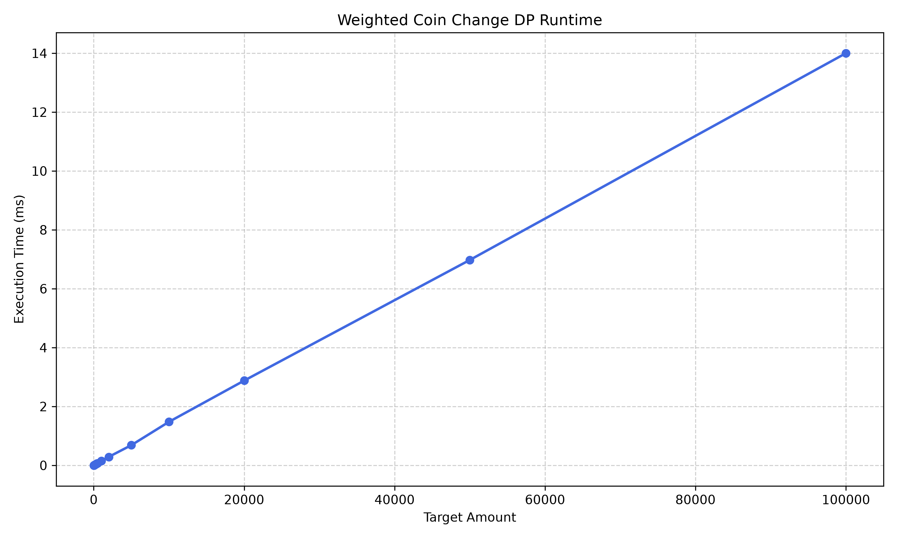
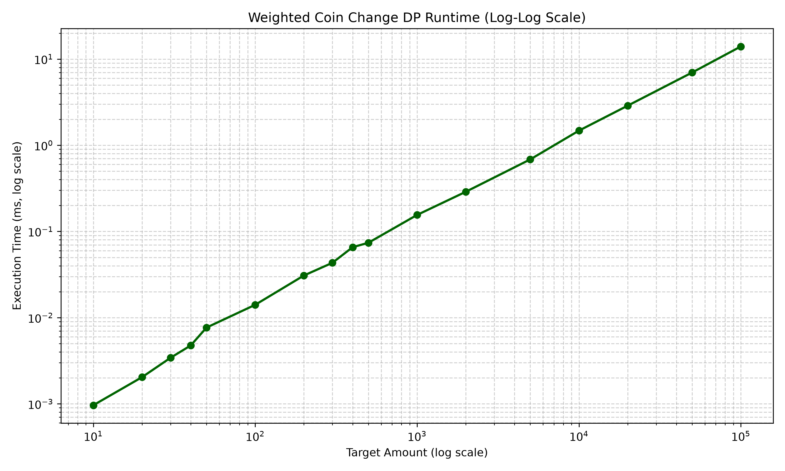

# Weighted Coin Change DP

A C++ implementation of a Dynamic Programming solution to the weighted coin change problem. The project helps Geralt the Witcher collect a target amount of ancient elvish coins while minimizing the total weight carried.

## Overview

Geralt is rewarded with ancient elvish coins after completing a monster-hunting quest.

Each coin denomination has:

- A monetary value.
- A physical weight.

The objective is to obtain a target amount while minimizing the total weight of coins carried.

This problem is solved using Dynamic Programming.

---

## Problem Statement

Given:

```text
A
```

a target amount and a set of coin types:

```text
(denomination1, weight1)
(denomination2, weight2)
...
(denominationn, weightn)
```

find a combination of coins whose total denomination equals:

```text
A
```

while minimizing the total weight.

Example:

| Denomination | Weight |
|-------------:|--------:|
| 1 | 10 |
| 2 | 5 |
| 5 | 2 |

Target:

```text
10
```

Possible solution:

```text
1+1+1+1+1+1+1+1+1+1
```

Weight:

```text
100
```

Optimal solution:

```text
5+5
```

Weight:

```text
4
```

---

## Data Structure

Each coin is represented by:

```cpp
struct Coin
{
    int denomination;
    int weight;
};
```

---

## Dynamic Programming Approach

The algorithm computes the minimum total weight needed to construct every amount from:

```text
0
```

to:

```text
A
```

A Dynamic Programming table is used:

```cpp
dp[x]
```

where:

```text
dp[x]
```

stores the minimum weight required to obtain amount:

```text
x
```

The final answer is:

```cpp
dp[A]
```

---

## Dynamic Programming Recurrence

Let:

```cpp
dp[x]
```

represent:

```text
The minimum total weight required
to obtain amount x.
```

### Base Case

The amount zero can be obtained without using any coins:

```cpp
dp[0] = 0;
```

All other entries are initialized to infinity:

```cpp
dp[i] = INF;
```

indicating that the amount has not yet been reached.

### Recurrence Relation

For every amount:

```cpp
x = 1 ... A
```

and for every available coin:

```cpp
coin.denomination
coin.weight
```

the state is updated using:

```cpp
dp[x] =
min(
    dp[x],
    dp[x - coin.denomination] + coin.weight
);
```

provided that:

```cpp
x >= coin.denomination
```

and amount:

```cpp
x - coin.denomination
```

has already been computed.

### Intuition

Suppose the algorithm wants to compute:

```text
dp[10]
```

and there exists a coin:

```text
denomination = 5
weight = 2
```

Then:

```cpp
dp[10]
=
dp[5] + 2
```

If the lightest way to obtain amount:

```text
5
```

has weight:

```text
2
```

then adding another coin of denomination:

```text
5
```

produces amount:

```text
10
```

with total weight:

```text
4
```

The algorithm evaluates every possible final coin and keeps the lightest valid solution.

---

## Why Unlimited Coin Usage Is Allowed

The Dynamic Programming formulation assumes that every coin denomination may be used an unlimited number of times.

This follows directly from the problem statement, which specifies the coin denominations and their weights but does not impose any limit on the number of available coins.

For example:

| Denomination | Weight |
|-------------:|--------:|
| 1 | 10 |
| 2 | 5 |
| 5 | 2 |

Target:

```text
10
```

Optimal solution:

```text
5 + 5
```

The denomination:

```text
5
```

is used twice.

The recurrence:

```cpp
dp[x] =
min(
    dp[x],
    dp[x - coin.denomination] + coin.weight
);
```

naturally allows this behavior because:

```cpp
dp[x - coin.denomination]
```

may already contain one or more copies of the same coin.

This problem is therefore an instance of the:

```text
Unbounded Coin Change Problem
```

where every denomination may be selected repeatedly.

---

## Correctness

The recurrence is correct because of the optimal substructure property.

An optimal solution for amount:

```text
x
```

can always be expressed as:

```text
Optimal solution for
x - coin.denomination
```

plus one final coin.

Since all possible final coins are considered and the minimum weight is chosen, the algorithm always finds the globally optimal solution.

---

## Complexity Analysis

Let:

```text
A
```

be the target amount and:

```text
n
```

be the number of available coin denominations.

### Time Complexity

The algorithm iterates through every amount from:

```text
0
```

to:

```text
A
```

For each amount, it examines every coin denomination:

```cpp
for (int current = 1; current <= amount; current++)
{
    for (const Coin& coin : coins)
    {
        ...
    }
}
```

The outer loop executes:

```text
A
```

times, while the inner loop executes:

```text
n
```

times for each amount.

Therefore, the total running time is:

```text
O(A · n)
```

### Space Complexity

The algorithm stores a Dynamic Programming table:

```cpp
vector<int> dp(amount + 1);
```

containing one entry for every amount from:

```text
0
```

to:

```text
A
```

Therefore, the memory usage is:

```text
O(A)
```

---

## Complexity Discussion

The theoretical complexity of the algorithm is:

```text
Time:  O(A · n)
Space: O(A)
```

where:

```text
A = target amount
n = number of coin denominations
```

During the benchmark, however, the number of coin denominations was fixed:

```cpp
{
    {1, 10},
    {2, 5},
    {5, 2},
    {10, 4},
    {20, 6},
    {50, 10}
}
```

which means:

```text
n = 6
```

remained constant throughout all experiments.

As a result:

```text
O(A · n)
=
O(A · 6)
=
O(A)
```

for the benchmarked configuration.

Consequently, the measured runtime grows approximately linearly with the target amount. This behavior is clearly visible in the experimental results:

```text
1000   -> 0.155 ms
10000  -> 1.478 ms
100000 -> 14.000 ms
```

Increasing the target amount by a factor of ten resulted in an approximately tenfold increase in execution time, closely matching the theoretical prediction.

---

## Benchmarking Methodology

Execution time was measured using:

```cpp
QueryPerformanceCounter()
```

from the Windows API.

Benchmark amounts:

```text
10
20
30
40
50
100
200
300
400
500
1000
2000
5000
10000
20000
50000
100000
```

Coin denominations used during benchmarking:

```cpp
{
    {1, 10},
    {2, 5},
    {5, 2},
    {10, 4},
    {20, 6},
    {50, 10}
};
```

Average execution times were recorded and exported to:

```text
data/benchmark.csv
```

---

## Experimental Results

Example execution:

```text
Minimum weight for 10 = 4
```

which corresponds to:

```text
5 + 5
```

with total weight:

```text
4
```

### Benchmark Results

| Target Amount | Time (ms) |
|--------------:|----------:|
| 10 | 0.00096 |
| 20 | 0.00204 |
| 50 | 0.00766 |
| 100 | 0.01408 |
| 500 | 0.07385 |
| 1000 | 0.15538 |
| 5000 | 0.68512 |
| 10000 | 1.47776 |
| 50000 | 6.97672 |
| 100000 | 14.00030 |

The benchmark demonstrates almost perfectly linear growth with respect to the target amount.

Measured results:

```text
1000   -> 0.155 ms
10000  -> 1.478 ms
100000 -> 14.000 ms
```

Increasing the target amount by a factor of ten resulted in an approximately tenfold increase in execution time.

Although the theoretical complexity is:

```text
O(A · n)
```

the number of coin denominations remained fixed during benchmarking:

```text
n = 6
```

Therefore, the observed behavior approaches:

```text
O(A)
```

which is clearly visible in the benchmark results and logarithmic graph.

---

## Generated Figures

### Runtime Comparison



The runtime comparison graph shows a steady increase in execution time as the target amount grows. Since theble stores one state for every amount from:

```text
0
```

to:

```text
A
```

larger target values require proportionally more work.

---

### Logarithmic Runtime Comparison



The logarithmic graph reveals an almost straight-line trend over several orders of magnitude, indicating near-linear growth.

This behavior is consistent with the theoretical complexity:

```text
O(A · n)
```

where:

```text
A = target amount
n = number of coin denominations
```

Since the number of coin denominations remained constant during testing:

```text
n = 6
```

the observed runtime approaches:

```text
O(A)
```

The benchmark data supports this conclusion:

```text
1000   -> 0.155 ms
10000  -> 1.478 ms
100000 -> 14.000 ms
```

which closely matches linear growth.

---

## Setup

### Prerequisites

- C++17 compatible compiler
- Windows operating system
- Python 3.13+ (for graph generation)

---

## Build

```bash
g++ src/main.cpp src/DPSolver.cpp -o benchmark
```

---

## Usage

Run:

```bash
./benchmark.exe
```

The program:

1. Solves the weighted coin change problem.
2. Computes the minimum total weight.
3. Benchmarks the Dynamic Programming algorithm.
4. Exports benchmark results.

Example output:

```text
Minimum weight for 10 = 4

Amount: 1000 | Time: 0.155 ms
Amount: 10000 | Time: 1.478 ms
Amount: 100000 | Time: 14.000 ms
```

---

## Benchmark Output

Generated automatically:

```text
data/data.csv
```

Format:

```csv
Amount,TimeMs
10,0.00096
20,0.00204
...
100000,14.00030
```

---

## Generate Graphs

Install dependencies:

```bash
py -3.13 -m pip install pandas matplotlib
```

Run:

```bash
py -3.13 graph.py
```

Generated files:

```text
report/
├── runtime_comparison.png
└── runtime_logarithmic.png
```

---

## Project Structure

```text
weighted-coin-change-dp
│
├── data/
│   └── data.csv
│
├── report/
|   |── graph.py
│   ├── runtime_comparison.png
│   └── runtime_logarithmic.png
│
├── src/
│   ├── Coin.h
│   ├── DPSolver.h
│   ├── DPSolver.cpp
│   └── main.cpp
│
├
├── README.md
└── benchmark.exe
```

---

## Conclusion

A Dynamic Programming solution was implemented to solve the weighted coin change problem by minimizing the total weight of coins required to obtain a target amount.

The algorithm exploits optimal substructure by storing the minimum-weight solution for every intermediate amount and reusing those results through the recurrence:

```cpp
dp[x] =
min(
    dp[x],
    dp[x - coin.denomination] + coin.weight
);
```

Experimental evaluation confirmed the expected:

```text
O(A · n)
```

time complexity.

Because the number of coin denominations remained constant throughout the benchmark, the measured runtime exhibited approximately linear growth with respect to the target amount. Increasing the amount from:

```text
1,000
```

to:

```text
10,000
```

and from:

```text
10,000
```

to:

```text
100,000
```

resulted in approximately tenfold increases in execution time, matching the theoretical prediction.

The Dynamic Programming approach guarantees an optimal solution while remaining efficient even for large target amounts.

---

## Author

**Desire Roslin Dziele**  
Computer Science Student  
University of Łódź